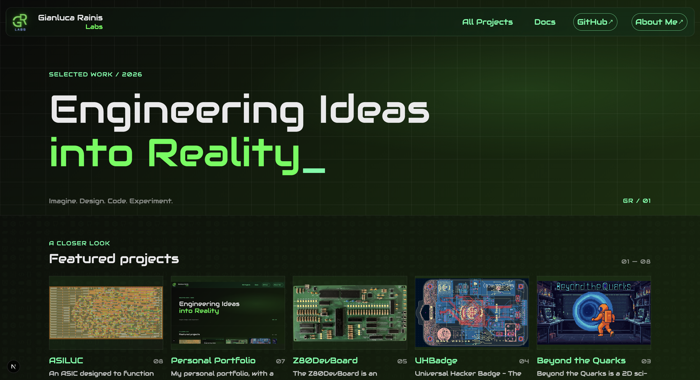

# Personal Portfolio


This is my personal portfolio, a high-tech inspired site designed to showcase my projects, with documentation, research and guides all in one place.

The **home page** of the site is the first thing that the visitor sees.
That's why I consider it important to display the current **featured projects** and all my other projects, so a visitor can have a preview of my projects.
It also works as a **manifesto** for the website, showing the motto "*Engineering Ideas into Reality*", transmitting the philosophy of my projects and of the website.

Other important pages are the **projects page**, where all my projects are displayed, with filters, sorting and search functions and the **docs page**, where all the documentation, documents, research and guides about the projects are available.

The **project pages** are the most important parts of the website, in fact those are the pages that have the role to show and explain a project to the visitor, with both technical and practical information.

Another important page is the **document page**, with integrated *mdx rendering* and *document metadata*, that allows you to write the documentation in markdown, adding additional information for the header of the document and for the filters of the docs page.

> **Live site**: [https://projects.gianlucarainis.com](https://projects.gianlucarainis.com)



## Tech Stack
- **Next.js**
- **React**
- **MDX** (for the documentation)

## Author
The author of the whole project is:
**Gianluca Rainis** - [gianluca-rainis](https://github.com/gianluca-rainis) on GitHub.

## AI Disclaimer
**Parts of this project** (including code and part of the UI) were developed with the **assistance of AI tools**.

**All content has been carefully reviewed, tested, adapted, modified, and curated by the author.**

## License
This project is under the MIT License.

## Project Structure
```
personalPortfolio/
├── components/               # UI pieces of the site
├── data/                     # Project information
├── docs/                     # The documentation to show in the Docs section
├── lib/                      # Implementation of internal functions
├── pages/                    # Site pages
├── public/                   # Images and downloadable files
├── styles/                   # Global styles and CSS modules
├── .gitattributes            # Gitattributes file
├── .gitignore                # Gitignore file
├── icon.png                  # The website icon
├── jsconfig.json             # JavaScript Configuration
├── LICENSE.md                # MIT License
├── mdx-components.tsx        # Component to support the mdx files rendering
├── next.config.js            # Next.js Configuration
├── next.config.mjs           # Next.js Configuration to support the mdx files
├── package.json              # Project Configuration
├── README.md                 # This file
├── robots.txt                # Robots file
└── sitemap.xml               # The Sitemap
```

## Development and Production
### Development
```bash
npm run dev
```

Open [http://localhost:3000](http://localhost:3000) in your browser.

### Production build
```bash
npm run build
npm start
```
